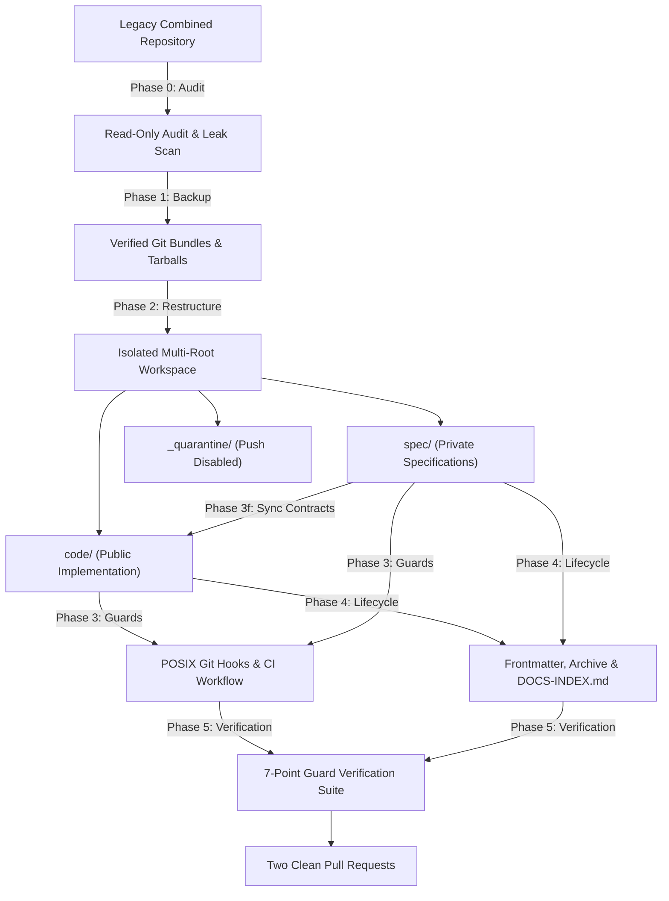

<div align="center">

# 🛡️ Dual-Repo Workspace Guard & Doc Lifecycle

**Universal AI agent skill and CLI for isolating dual-repo workspaces, installing cross-repo anti-leak git guards, contract sync, and document lifecycle schemas.**

[](https://opensource.org/licenses/MIT)
[](https://github.com/imMamdouhaboammar/dual-repo-workspace-guard)
[](https://github.com/imMamdouhaboammar/dual-repo-workspace-guard)
[](https://github.com/imMamdouhaboammar/dual-repo-workspace-guard)

</div>

---

## 📖 Overview

When developing systems that split public implementation code and private specifications/ADRs across two GitHub repositories, managing them in a single local folder creates severe risks of cross-contamination, accidental leaks, and unverified git pushes.

`dual-repo-workspace-guard` provides an enterprise-grade, 5-phase pipeline to:
1. **Audit & Leak Scan:** Read-only inspection of history, branches, stashes, and remotes.
2. **Zero-Loss Backup:** Verified Git bundles (`git bundle verify`) and working-tree tarballs with SHA-256 digests.
3. **Restructure & Quarantine:** Clean isolated clones (strictly one remote each) and quarantined legacy repo with push disabled.
4. **Cross-Repo Guards:** Versioned POSIX `.githooks` (`pre-commit`, `pre-push`), GitHub Actions CI guard (`no-private-content`), Claude Code read-only sandbox, and unidirectional contract sync (`sync_contracts.py`).
5. **Document Lifecycle:** Standardized YAML frontmatter (`doc_id`, `lifecycle`, `status`, `review_by`), archive warning banners, automated `DOCS-INDEX.md`, and strict schema validator.
6. **7-Point Proof Suite:** Automated test suite proving all guards fail closed.

---

## 🏗️ Architecture & Execution Pipeline



---

## ⚡ Instant Installation

### 1. Via `npx` (Universal Multi-Agent Installer)
Installs the skill across all detected agent harnesses (**Claude Code**, **Antigravity / Gemini CLI**, **Cursor**, **Codex / OpenCode**, and **Universal Agent Kernel**):

```bash
npx github:imMamdouhaboammar/dual-repo-workspace-guard install
```

### 2. Via `skills.sh`
```bash
npx skills add imMamdouhaboammar/dual-repo-workspace-guard
```

### 3. Via One-Line Shell Script
```bash
curl -fsSL https://raw.githubusercontent.com/imMamdouhaboammar/dual-repo-workspace-guard/main/install.sh | bash
```

---

## 🚀 CLI Commands & Usage

You can run any phase directly using `npx`:

```bash
# Phase 0: Run read-only audit & history leak scan
npx github:imMamdouhaboammar/dual-repo-workspace-guard audit --config workspace-config.json --repo /path/to/old-repo

# Phase 1: Create verified git bundles & tar archives
npx github:imMamdouhaboammar/dual-repo-workspace-guard backup --config workspace-config.json --repo /path/to/old-repo

# Phase 2: Restructure workspace into clean clones and quarantine old repo
npx github:imMamdouhaboammar/dual-repo-workspace-guard restructure --config workspace-config.json --repo /path/to/old-repo

# Phase 3: Install .githooks, CI guard, Claude settings, and contract sync
npx github:imMamdouhaboammar/dual-repo-workspace-guard install-guards --config workspace-config.json

# Phase 3f: Synchronize contract schemas with SHA-256 provenance
npx github:imMamdouhaboammar/dual-repo-workspace-guard sync-contracts --spec ../spec --commit <sha>

# Phase 4: Validate document lifecycles and schemas
npx github:imMamdouhaboammar/dual-repo-workspace-guard validate-docs --repo ./spec --expected-visibility private

# Phase 4d: Generate categorized DOCS-INDEX.md
npx github:imMamdouhaboammar/dual-repo-workspace-guard generate-docs-index --repo ./spec

# Phase 5: Run the 7-point guard verification test suite
npx github:imMamdouhaboammar/dual-repo-workspace-guard verify-guards --workspace ~/Documents/project-workspace --code-remote <code-url> --spec-remote <spec-url>
```

---

## ⚙️ Configuration Schema (`workspace-config.json`)

```json
{
  "project_name": "MyProject",
  "workspace_root": "~/Documents/myproject-workspace",
  "code_repo": {
    "name": "code",
    "remote_url": "https://github.com/myorg/myproject-code.git",
    "visibility": "public",
    "doc_prefix": "MYPROJ-CODE"
  },
  "spec_repo": {
    "name": "spec",
    "remote_url": "https://github.com/myorg/myproject-spec.git",
    "visibility": "private",
    "doc_prefix": "MYPROJ-SPEC"
  },
  "guard_rules": {
    "spec_only_paths": [
      "product/",
      "research/",
      "specs/",
      "delivery/",
      "architecture/ADRs/",
      "DECISION-REGISTER.md"
    ],
    "allowed_contract_patterns": [
      "contracts/schemas/*.json",
      "contracts/examples/*.json"
    ]
  },
  "document_lifecycle": {
    "owner": "Mamdouh Aboammar",
    "default_review_horizon_months": 6
  }
}
```

---

## 🛡️ The 7 Proof Points (Fail-Closed Verification)

Before delivering changes, the verification runner validates:
1. `code/` `git push --dry-run` to private remote URL is **refused**.
2. `spec/` `git push --dry-run` to public remote URL is **refused**.
3. `code/` pre-commit hook **blocks** staged private files or `visibility: private` frontmatter.
4. CI workflow **fails** when forbidden spec paths are introduced.
5. Claude Code permission sandbox **denies write operations** outside the code repo.
6. `sync_contracts.py` **rejects** dirty spec trees, wrong commits, or non-contract paths, and passes clean syncs with SHA-256 provenance logging.
7. `validate_docs.py` **passes** clean docs and **fails immediately** if an archive banner is removed.

---

## 🔒 Absolute Invariants

- **Safety Precedes Speed:** Every destructive or outward-facing step is preceded by a verified backup.
- **One Remote Per Repository:** No repository ever gets the other repository as a remote.
- **Strict Ban on `--no-verify`:** Bypassing git hooks is strictly forbidden.
- **Preserve Historical Content:** Archived documents retain original relative paths and body text without alteration.
- **Fail-Closed Design:** Any unexpected layout, third remote, or leak in history halts execution immediately for owner review.

---

## 📄 License

MIT © [Mamdouh Aboammar](https://github.com/imMamdouhaboammar)
